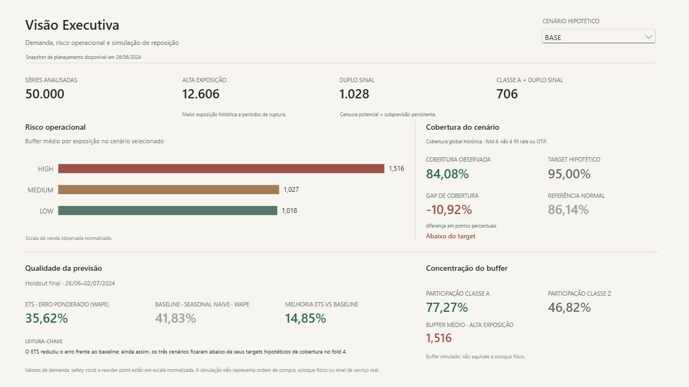
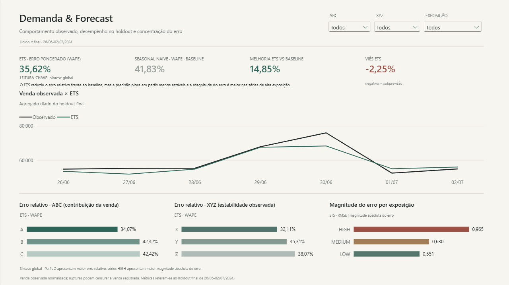
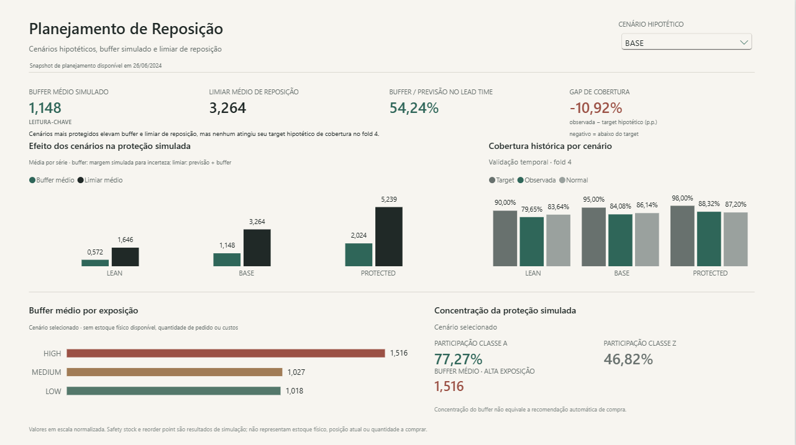
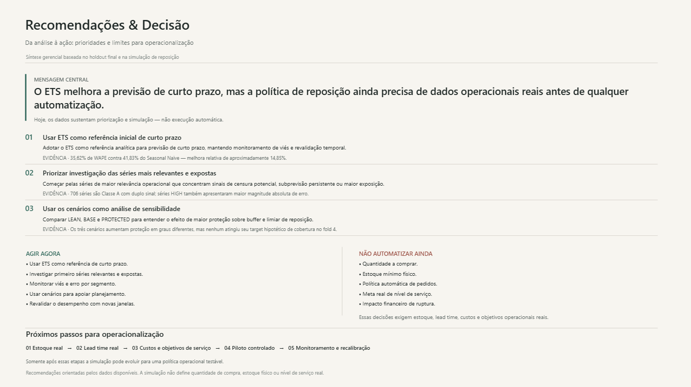

# Previsão de Demanda no Varejo

Forecasting, risco operacional e simulação de reposição a partir de dados reais de varejo.

> Como identificar quando a venda observada subestima a demanda, prever a demanda de curto prazo e transformar essa previsão em sinais de risco e decisões de reposição no varejo?

O projeto conecta qualidade de dados, previsão temporal, validação fora da amostra,
diagnóstico de risco e simulação de reposição a um relatório Power BI voltado à decisão.
Identifica **sinais de possível censura da venda**, sem tratar demanda latente ou vendas
perdidas como quantidades conhecidas. O alvo previsto é a venda observada normalizada.

## Em 30 segundos

- **Previsão:** no holdout final, o ETS reduziu o WAPE de **41,83% para 35,62%**, melhoria relativa de **14,85%** frente ao Seasonal Naive.
- **Investigação:** **1.028 séries** apresentam duplo sinal histórico de censura potencial e subprevisão persistente; **706** pertencem à Classe A.
- **Reposição:** aumentar proteção elevou buffer e limiar simulados, mas **nenhum cenário atingiu seu target hipotético no fold 4**.
- **Decisão:** usar ETS como referência inicial, investigar séries relevantes e expostas e validar estoque, lead time e custos reais antes de automatizar pedidos.

Desenvolvimento analítico e páginas Power BI concluídos e aprovados. Dados e artefatos
locais ficam fora do Git. As quatro capturas finais estão na seção Power BI abaixo.

## Em 3 minutos

### Dados e fronteira temporal

[FreshRetailNet-50K](https://huggingface.co/datasets/Dingdong-Inc/FreshRetailNet-50K),
publicado por Dingdong-Inc no Hugging Face sob **CC BY 4.0**:
**50.000 séries loja–produto, 898 lojas, 865 produtos e 18 cidades**.

| Recorte | Período | Papel |
|---|---|---|
| Train | 28/03/2024–25/06/2024 | 90 dias para análise, segmentação e quatro folds temporais |
| Holdout final | 26/06/2024–02/07/2024 | Uma semana avaliada após congelar as decisões |

Os arquivos oficiais são identificados por revisão e SHA-256 em
[source_manifest.yaml](config/source_manifest.yaml). A documentação da fonte cita
863 produtos em alguns trechos; os arquivos observados contêm **865**, adotados como
fonte de verdade. Os dados originais não são distribuídos neste repositório.

### Resultado fora da amostra

| Modelo | WAPE | RMSE |
|---|---:|---:|
| Seasonal Naive | 41,83% | 0,836 |
| ETS A/N/A | **35,62%** | **0,711** |

A melhoria relativa é `(WAPE baseline − WAPE ETS) / WAPE baseline`. RMSE está na escala
normalizada da fonte. O ETS usa sazonalidade semanal aditiva, sem tendência; os
resultados preservam fallback e clipping auditáveis. Detalhes no
[relatório do holdout](docs/final_holdout_evaluation_report.md).

O erro histórico apresentou associação com o erro futuro (Spearman aproximadamente
0,725–0,740). Séries HIGH tiveram maior magnitude absoluta de erro. Essas relações
são descritivas e podem refletir escala; não demonstram causalidade ou demanda perdida.
O [relatório de risco](docs/forecast_uncertainty_and_risk_report.md) diferencia exposição,
censura potencial e persistência de subprevisão.

### Simulação de reposição

| Cenário hipotético | Buffer médio (SS) | Limiar médio (ROP) | Cobertura histórica, fold 4 | Target |
|---|---:|---:|---:|---:|
| LEAN | 0,572 | 1,646 | 79,65% | 90% |
| BASE | 1,148 | 3,264 | 84,08% | 95% |
| PROTECTED | 2,024 | 5,239 | 88,32% | 98% |

SS e ROP são **simulações em escala normalizada**, não estoque físico nem quantidade
a comprar. As médias descrevem o snapshot final; a cobertura é resultado histórico
do fold 4, não realização futura desse snapshot. Nenhum target nominal foi atingido.
Os cenários apoiam análise de sensibilidade; BASE e PROTECTED não são recomendações
automáticas. Consulte o [relatório de reposição](docs/replenishment_simulation_report.md).

### Arquitetura e metodologia


O fluxo cobre ingestão/quality, demand understanding, ABC/XYZ/exposure, baselines
temporais, ETS, holdout final, incerteza/risco, simulação de reposição, modelo semântico
e comunicação gerencial. O risco histórico foi congelado antes do holdout; sua
associação com erro futuro foi examinada depois. Os folds usam snapshots prospectivos,
sem reutilizar segmentação full-train como se fosse conhecida no passado.

Implementação em `src/`, consultas em `sql/`, parâmetros em `config/`, execução em
`scripts/`, testes em `tests/` e notebooks em `notebooks/`. `data/raw`, `staging`,
`processed`, `outputs` e `powerbi/data` são locais e ignorados.

## Power BI

| Página visível | Pergunta atendida |
|---|---|
| 01 Visão Executiva | Quais são os principais riscos e resultados? |
| 02 Demanda & Forecast | Como se comportam a venda, a previsão e o erro? |
| 03 Planejamento de Reposição | Como os cenários alteram a proteção simulada? |
| 04 Recomendações & Decisão | Onde agir, o que investigar e o que ainda não automatizar? |

### 01 — Visão Executiva



Síntese dos resultados e riscos para orientar a investigação.

### 02 — Demanda & Forecast



Comportamento observado, confiabilidade da previsão e concentração do erro.

### 03 — Planejamento de Reposição



Cenários hipotéticos e seus efeitos sobre a proteção simulada.

### 04 — Recomendações & Decisão



Prioridades, limites e próximos passos antes de operacionalizar as decisões.

**00 Validação** permanece como auditoria interna, oculta na navegação de leitura.
As definições [PBIP](powerbi/previsao-demanda-varejo.pbip), PBIR Enhanced e TMDL são
versionáveis; o PBIX e os CSVs gerados permanecem locais.

Antes do primeiro refresh, configure **`pPowerBIDataRoot`** para `<repo>\powerbi\data`.
O valor publicado é um placeholder genérico, não uma descoberta automática da pasta.
Veja [como abrir e configurar o relatório](docs/powerbi_report.md), o
[contrato de dados](docs/powerbi_data_contract.md), o
[catálogo de medidas](docs/powerbi_measures.md) e o
[sistema visual](docs/powerbi_visual_system.md).

## Limitações que orientam a decisão

- `sale_amount` é normalizado: não representa receita nem unidades físicas. Preços e custos completos não estão disponíveis.
- Não há posição completa de estoque, pedidos/PO ou lead time real; a simulação não produz quantity-to-order.
- São 90 dias de histórico e sete dias de holdout: não sustentam sazonalidade anual nem garantem estabilidade futura.
- Rupturas podem censurar a venda observada; não há mensuração de demanda latente ou lost sales.
- Cenários e targets são hipotéticos; cobertura não é fill rate, OTIF ou nível de serviço real validado.
- `eval` foi aberto no holdout final one-shot. Já não é uma amostra intocada: retuning exige novo desenho de validação.

## Reprodutibilidade

Os comandos abaixo existem no projeto e devem ser executados na raiz. A reprodução
integral é separada do fechamento e exige tempo, memória e artefatos das etapas anteriores.

### 1. Ambiente

```powershell
python -m venv .venv
.\.venv\Scripts\python.exe -m pip install .
.\.venv\Scripts\python.exe -m pip check
```

Python 3.12 ou superior. Dependências em [pyproject.toml](pyproject.toml); não há
lockfile de versões, portanto um ambiente futuro exige nova validação.

### 2. Ingestão e qualidade

```powershell
.\.venv\Scripts\python.exe scripts/ingest_data.py
.\.venv\Scripts\python.exe scripts/validate_raw.py
```

A ingestão obtém os arquivos da fonte oficial e verifica o manifesto; não baixa dados
pelo Git. Testes de integração dependem dos dados e outputs locais já construídos.

### 3. Análises

| Etapa | Script existente | Referência |
|---|---|---|
| Perfil de demanda | `scripts/build_demand_profile.py` | [Entendimento](docs/demand_understanding_report.md) |
| Segmentação | `scripts/build_segmentation.py` | [ABC/XYZ/exposição](docs/segmentation_report.md) |
| Backtesting de baselines | `scripts/run_baseline_backtest.py` | [Baselines](docs/forecasting_baselines_report.md) |
| ETS populacional | `scripts/run_statistical_forecast.py` | [ETS](docs/statistical_forecasting_report.md) |
| Risco histórico | `scripts/build_forecast_risk_profile.py` | [Incerteza](docs/forecast_uncertainty_and_risk_report.md) |
| Holdout final | `scripts/run_final_holdout.py` | [Protocolo one-shot](docs/final_holdout_protocol.md) |
| Reposição simulada | `scripts/build_replenishment_simulation.py` | [Protocolo](docs/replenishment_simulation_protocol.md) |

Não execute esses scripts indiscriminadamente sobre o trabalho congelado. O runner ETS
completo faz 200.000 ajustes. Com previsões existentes, oferece `--compare-only`; o
holdout oferece `--evaluate-only`. Reproduzir resultados não restaura a independência
de `eval`. Scripts `render_*.py` executam os notebooks de apresentação correspondentes.

### 4. Exportação e abertura do Power BI

```powershell
.\.venv\Scripts\python.exe scripts/build_powerbi_layer.py
```

Requer os marts congelados indicados no contrato e gera os seis CSVs em `powerbi/data/`.
Abra `powerbi/previsao-demanda-varejo.pbip` no Desktop e configure a fonte conforme
[powerbi_report.md](docs/powerbi_report.md). Um clone sem cache abre a definição sem dados;
o refresh local depende dos CSVs e da configuração do parâmetro.

### 5. Testes

`python -m pytest -q --basetemp=.tmp/pytest` executa a suíte completa, incluindo reproduções
populacionais e pequenos ajustes ETS. Para o fechamento sem fitting nem reconstrução,
as exclusões e o resultado estão em [validação final](docs/final_validation.md).

## Em 15–30 minutos

Comece pelo [walkthrough do portfólio](docs/portfolio_walkthrough.md). Depois consulte:

- [Metodologia](docs/methodology.md), [arquitetura](docs/architecture.md) e [decisões](docs/decisions.md).
- [Qualidade](docs/data_quality_report.md), [dicionário](docs/data_dictionary.md) e [limitações](docs/limitations.md).
- [Holdout final](docs/final_holdout_evaluation_report.md), [incerteza](docs/forecast_uncertainty_and_risk_report.md) e [reposição](docs/replenishment_simulation_report.md).
- [Notebooks](notebooks/), [implementação](src/) e [testes](tests/).

**Stack utilizada:** Python, pandas, NumPy, statsmodels, DuckDB, PyArrow, pytest,
matplotlib/Jupyter, Power BI, DAX, PBIP/PBIR e Git. scikit-learn integra o ambiente e
o teste de importação; não foi usado para treinar um modelo adicional.

## Decisões de desenvolvimento e evidências

O [índice de evidências](docs/development_decisions_and_evidence.md) reúne referências
a commits, decisões, correções e validações, com seus limites de evidência.
